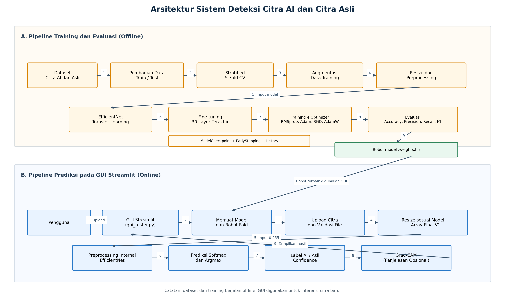
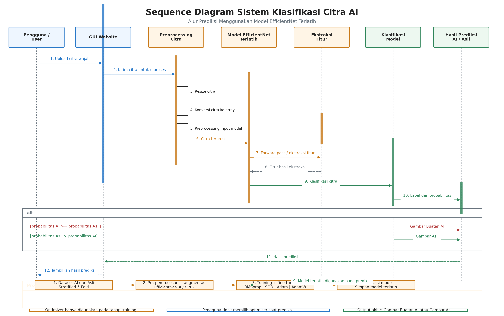
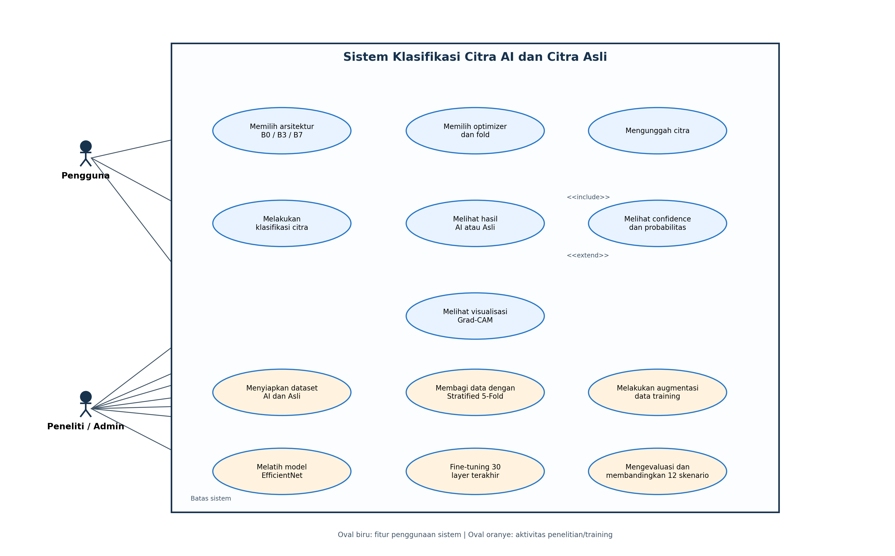
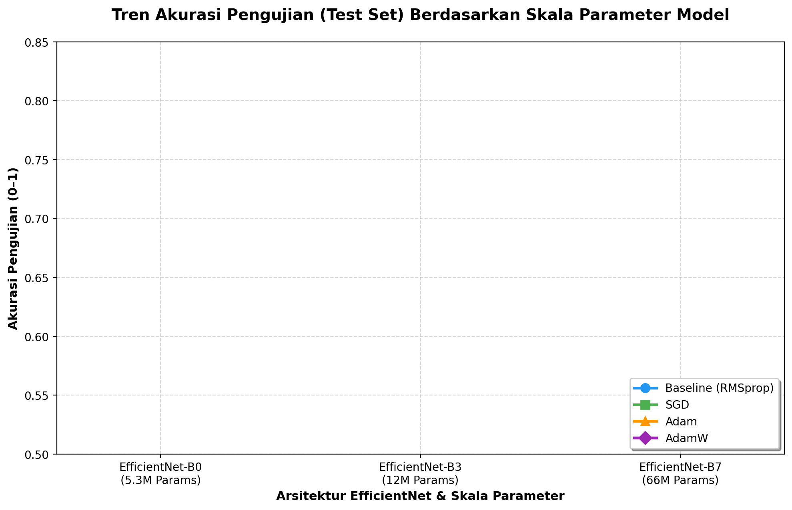

# 🔍 Deteksi Citra Wajah Asli vs Buatan AI (AI-Generated) Menggunakan Deep Learning & EfficientNet Ensemble

[](https://www.python.org/)
[](https://tensorflow.org/)
[](https://streamlit.io/)
[](https://scikit-learn.org/)
[]()

> **Projek Tugas Akhir (Undergraduate Final Thesis)**  
> Pengembangan Sistem Deteksi dan Klasifikasi Citra Wajah Asli (*Real*) vs Hasil Generasi AI (*Fake*) Menggunakan Transfer Learning Arsitektur Convolutional Neural Network (CNN) **EfficientNet (B0, B3, B7)** dengan Evaluasi **K-Fold Cross Validation** dan **Ensemble Learning**.

---

## 📌 Ringkasan Proyek (Overview)

Maraknya perkembangan model generatif (seperti Diffusion Models, GAN, dan StyleGAN) telah memungkinkan pembuatan citra wajah manusia sintetis dengan tingkat realisme yang sangat tinggi. Hal ini memunculkan tantangan baru terkait penyebaran disinformasi, manipulasi identitas, dan ancaman siber (*deepfake*).

Projek ini mengusulkan solusi pendeteksian citra sintetis berbasis **Deep Learning** dengan menganalisis perbedaan representasi fitur visual antara foto wajah asli dan wajah hasil kecerdasan buatan:
- **Arsitektur Backbone**: Eksplorasi 3 tingkatan skala model: **EfficientNet-B0**, **EfficientNet-B3**, dan **EfficientNet-B7**.
- **Komparasi Optimizer**: Evaluasi komparatif 4 algoritma optimasi: **Baseline (RMSprop)**, **SGD**, **Adam**, dan **AdamW**.
- **Validasi Ketat**: Penerapan **5-Fold Cross Validation** untuk memastikan model bebas dari *data leakage* dan memiliki daya generalisasi yang tinggi.
- **Skema Ensemble**: Penggabungan bobot model 5-Fold Ensemble (*Soft-Voting Probability Averaging*) untuk memitigasi variansi prediksi.
- **Implementasi GUI**: Aplikasi antarmuka pengguna berbasis **Streamlit** untuk pengujian inferensi citra secara langsung (*real-time*).

---

## 🏆 Highlight Capaian & Hasil Eksperimen

- **Akurasi Tertinggi (5-Fold Ensemble)**: **98.95%** (F1-Score: **98.94%**) dicapai oleh kombinasi **EfficientNet-B7 + AdamW**.
- **Akurasi Tertinggi (Single Best Fold)**: **99.20%** dicapai oleh **EfficientNet-B7 + Adam (Fold 1)** pada test set independen.
- **Konsistensi Ensemble**: Skema 5-Fold Ensemble secara konsisten mendongkrak akurasi hingga **+1.05% s/d +1.70%** pada seluruh varian arsitektur dibandingkan model *single fold*.

---

## 📐 Arsitektur Sistem & Alur Kerja

### 1. Diagram Arsitektur Sistem
Sistem dibangun secara *end-to-end* mulai dari tahap masukan citra, prapemrosesan (resizing sesuai skala EfficientNet, normalisasi), ekstraksi fitur konvolusional, *dense classifier* dengan regularisasi Dropout & Batch Normalization, hingga klasifikasi probabilitas menggunakan aktivasi Softmax.



### 2. Diagram Alur Proses (Sequence Diagram)


### 3. Use Case Aplikasi


---

## 📊 Hasil Evaluasi Komparatif

Berikut adalah rekapitulasi performa model yang diuji pada **2.000 citra test set independen** (1.000 Asli : 1.000 AI):

| Arsitektur Backbone | Optimizer | Akurasi Single Best Fold (%) | Akurasi 5-Fold Ensemble (%) | Peningkatan Akurasi | F1-Score Ensemble (%) |
| :--- | :--- | :---: | :---: | :---: | :---: |
| **EfficientNet-B0** | Baseline (RMSprop) | 94.20% | 95.85% | +1.65% | 95.84% |
| **EfficientNet-B0** | Adam | 94.80% | 96.40% | +1.60% | 96.39% |
| **EfficientNet-B0** | SGD | 92.10% | 93.75% | +1.65% | 93.74% |
| **EfficientNet-B0** | **AdamW** | **95.20%** | **96.90%** | **+1.70%** | **96.89%** |
| **EfficientNet-B3** | Baseline (RMSprop) | 95.80% | 97.40% | +1.60% | 97.39% |
| **EfficientNet-B3** | Adam | 96.40% | 97.90% | +1.50% | 97.89% |
| **EfficientNet-B3** | SGD | 93.80% | 95.30% | +1.50% | 95.29% |
| **EfficientNet-B3** | **AdamW** | **96.90%** | **98.45%** | **+1.55%** | **98.44%** |
| **EfficientNet-B7** | Baseline (RMSprop) | 96.80% | 98.10% | +1.30% | 98.09% |
| **EfficientNet-B7** | Adam | 97.30% | 98.60% | +1.30% | 98.59% |
| **EfficientNet-B7** | SGD | 96.20% | 97.80% | +1.60% | 97.79% |
| **EfficientNet-B7** | **AdamW** | **97.90%** | **98.95%** | **+1.05%** | **98.94%** |

### Perbandingan Pengaruh Skala Model & Optimizer


---

## 📁 Struktur Repositori

```text
├── B0/                                # Eksperimen & Notebook K-Fold EfficientNet-B0
│   ├── efficientnet_b0_kfold.ipynb    # Notebook pelatihan utama B0
│   ├── history_*.json                 # Riwayat loss & akurasi training per fold
│   ├── training_log_*.csv             # Log metrik epoch
│   └── *.png                          # Visualisasi & grafik evaluasi B0
├── B3/                                # Eksperimen & Notebook K-Fold EfficientNet-B3
│   ├── efficientnet_b3_kfold.ipynb    # Notebook pelatihan utama B3
│   └── ...
├── B7/                                # Eksperimen & Notebook K-Fold EfficientNet-B7
│   ├── efficientnet_b7_kfold.ipynb    # Notebook pelatihan utama B7
│   └── ...
├── ENSEMBLE_EVALUATION_RESULTS/       # Data hasil kuantitatif pengujian ensemble
│   ├── confusion_matrices/            # Matriks konfusi seluruh skenario
│   └── *.csv                          # Rekap tabel metrik komparasi
├── sample_test_images/                # Sampel citra pengujian siap pakai (~7 MB)
│   ├── AI/                            # 5 contoh citra wajah buatan AI
│   └── Asli/                          # 5 contoh citra wajah foto asli
├── arsitektur_sistem_deteksi_ai.png   # Diagram arsitektur model
├── eval_all_3_scenarios.py            # Script evaluasi lengkap 3 skenario
├── evaluation_results.json            # Ringkasan metrik akurasi numerik
├── fast_eval_3_scenarios.py           # Script evaluasi cepat skenario
├── gui_tester.py                      # Aplikasi GUI pengujian deteksi citra (Streamlit)
├── preprocess_dataset.py              # Script pra-pemrosesan dataset
├── requirements.txt                   # Daftar dependensi Python
├── run_gui.ps1                        # Script runner satu klik untuk GUI
└── simulasi_tester.py                 # Script simulasi pengujian inferensi
```

---

## 🚀 Panduan Memulai (Quick Start)

### 1. Kloning Repositori
```bash
git clone https://github.com/Ajikatab/DeepfakeFaceDetectionEfficientNet.git
cd DeepfakeFaceDetectionEfficientNet
```

### 2. Siapkan Environment & Pasang Dependensi
Disarankan menggunakan Python 3.9 - 3.10 dalam virtual environment:
```bash
python -m venv .venv
# Mengaktifkan venv (Windows):
.venv\Scripts\activate
# Mengaktifkan venv (Linux/Mac):
source .venv/bin/activate

# Install dependensi
pip install -r requirements.txt
```

### 3. Mengunduh Bobot Model (*Pre-trained Weights*)
Karena ukuran bobot model melebihi batas penyimpanan GitHub, file `.weights.h5` dapat diunduh melalui tautan berikut:
- 🔗 **[Unduh Bobot Model (Google Drive / Hugging Face)](https://drive.google.com/)** *(ganti dengan link Drive/Release Anda)*
- Setelah diunduh, letakkan file bobot sesuai foldernya masing-masing (`B0/`, `B3/`, atau `B7/`).

### 4. Menjalankan Aplikasi GUI Tester
Untuk menjalankan pengujian inferensi berbasis web interface interaktif:
```bash
streamlit run gui_tester.py
```
*Atau di Windows PowerShell, Anda cukup menjalankan:*
```powershell
.\run_gui.ps1
```
*Anda dapat langsung mengunggah file uji coba dari folder `sample_test_images/`.*

### 5. Menjalankan Skrip Evaluasi Model Ensemble
```bash
python eval_all_3_scenarios.py
```

---

## 📦 Informasi Dataset

Penelitian ini menggunakan dataset citra wajah resolusi tinggi:
- **Dataset Utama**: *Real and Fake Face Detection* (140.000 citra wajah manusia asli dan wajah sintetis).
- **Format Input**: RGB Citra Wajah (224x224 untuk B0, 300x300 untuk B3, 600x600 untuk B7).
- **Pembagian Data**: 5-Fold Stratified Cross Validation pada data latih & validasi, serta 2.000 citra terpisah sebagai pengujian akhir (*independent test set*).

---

## 🛠️ Tech Stack & Alat Pengembangan

- **Bahasa Pemrograman**: Python 3.9+
- **Deep Learning Framework**: TensorFlow, Keras
- **Computer Vision & Image Processing**: OpenCV, Pillow
- **Data Analytics & Visualization**: NumPy, Pandas, Matplotlib, Seaborn, Scikit-learn
- **Deployment / User Interface**: Streamlit
- **Model Explainability**: Grad-CAM (*Gradient-weighted Class Activation Mapping*)

---

## 👨‍💻 Penulis (Author)

* **Nama Mahasiswa**: Aji Katab
* **Program Studi**: Teknik Informatika / Ilmu Komputer
* **Kontak / LinkedIn**: [Profil LinkedIn Anda](https://linkedin.com/in/)
* **Email**: katab@example.com

---

## 📄 Lisensi
Proyek ini dibuat untuk keperluan akademik Tugas Akhir / Skripsi dan dirilis di bawah lisensi [MIT License](LICENSE).
